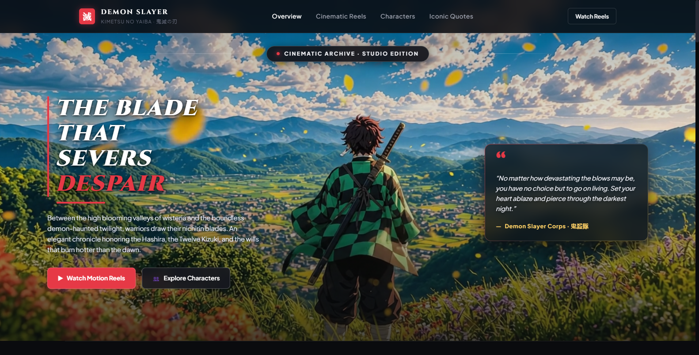
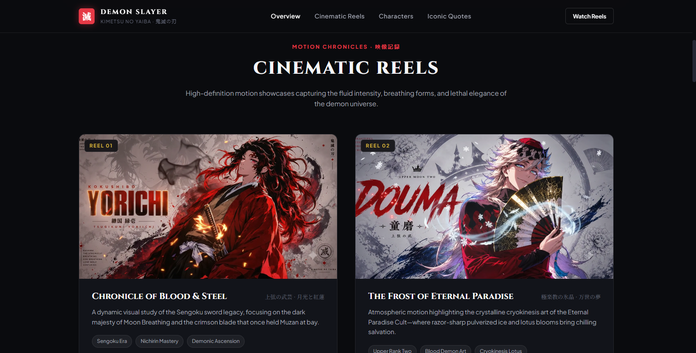
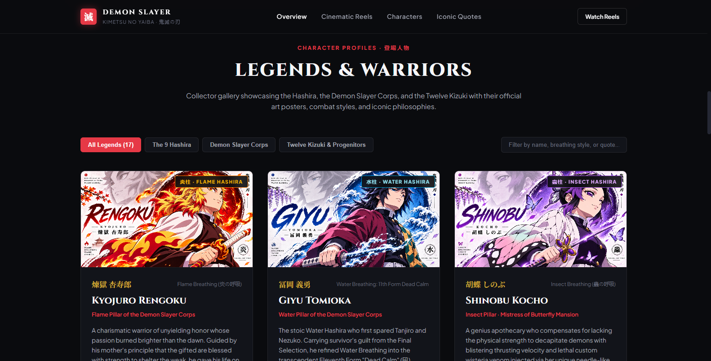
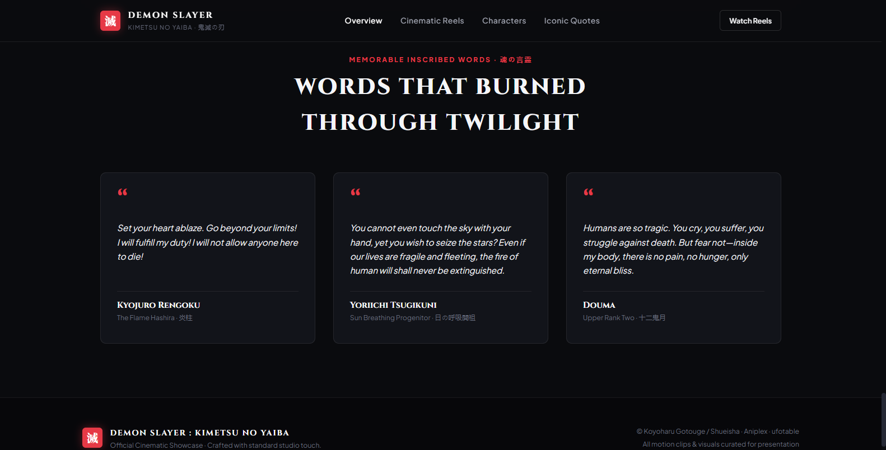

# ⚔️ Demon Slayer: Kimetsu no Yaiba — Cinematic Web Archive

<div align="center">

[](https://developer.mozilla.org/en-US/docs/Web/HTML)
[](https://developer.mozilla.org/en-US/docs/Web/CSS)
[](https://developer.mozilla.org/en-US/docs/Web/JavaScript)
[](LICENSE)

A cinematic, studio-grade Demon Slayer web archive celebrating the Hashira, Twelve Kizuki, breathing techniques, motion reels, and iconic quotes.

<br/>



</div>

---

## 📸 Previews

| Cinematic Hero Section | Motion Video Reels |
| :---: | :---: |
|  |  |
| **Tanjiro Kamado Overview** | **Dynamic Battle Cinematics** |

| Character Lore & Hashira | Iconic Quotes Chronicle |
| :---: | :---: |
|  |  |
| **Interactive Character Codex** | **Memorable Anime Dialogue** |

---

## ✨ Features

- ⚔️ **Cinematic Motion Reels**: High-definition video player showcasing iconic battle sequences.
- 🥋 **Interactive Character Codex**: Detailed character profiles for Tanjiro, Nezuko, the 9 Hashira, and Upper Moons.
- 💬 **Memorable Quotes Archive**: Inspiring and emotional dialogue with Japanese typography accents.
- 🎨 **Studio Aesthetic**: Dark-themed Japanese visual styling featuring custom wisteria particle atmospheres and Cinzel typography.
- 📱 **Fully Responsive**: Smoothly adapts to mobile, tablet, and desktop viewports.
- ⚡ **Zero Dependencies**: Pure HTML5, CSS3, and modern vanilla JavaScript.

---

## 🎮 Navigation

| Section | Description |
| :--- | :--- |
| **Overview** | Hero banner with motion backdrop and story synopsis |
| **Cinematic Reels** | Curated video gallery of battles and breathing forms |
| **Characters** | Character cards with breathing styles, ranks, and bios |
| **Iconic Quotes** | Famous lines honoring the Demon Slayer Corps and Kizuki |

---

## 🚀 How to Run

1. **Option A (Direct)**: Double-click `index.html` in your file explorer.
2. **Option B (Local Server)**:
   ```bash
   python -m http.server 8000
   ```
   Then open [`http://localhost:8000`](http://localhost:8000) in your browser.

---

## 📄 License

MIT License © 2026 [Sooraj Studio](https://github.com/soorajstudio)
